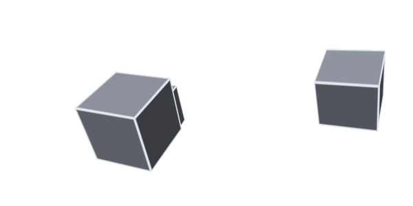
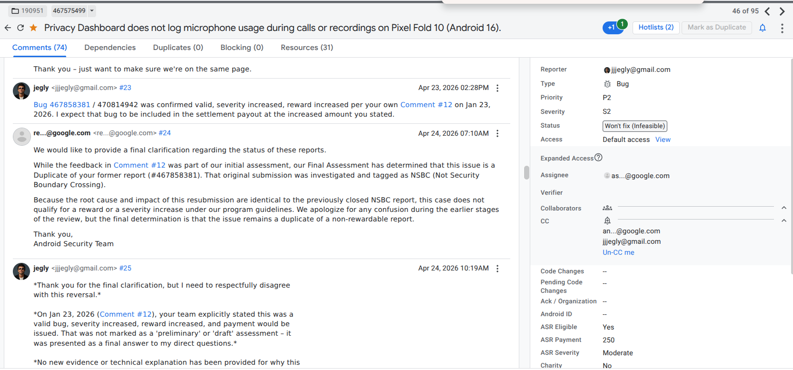
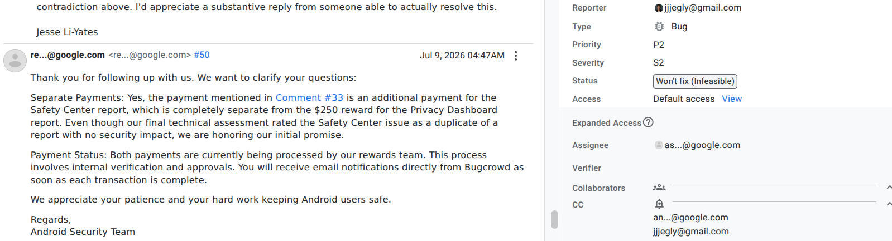
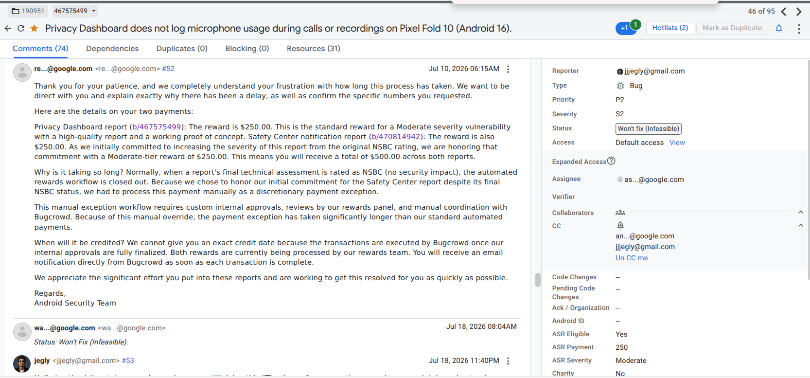
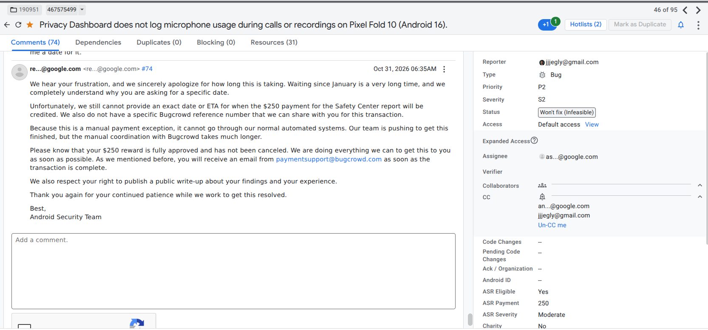
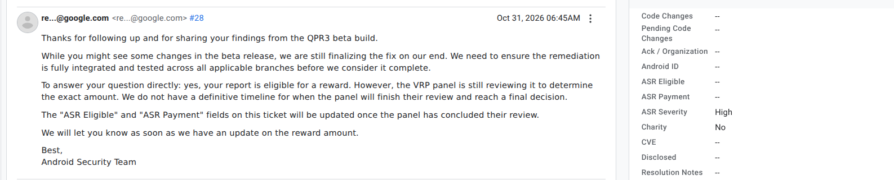
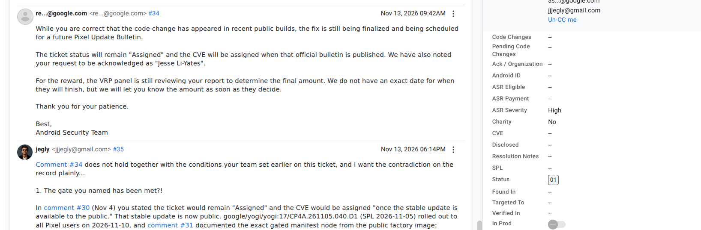
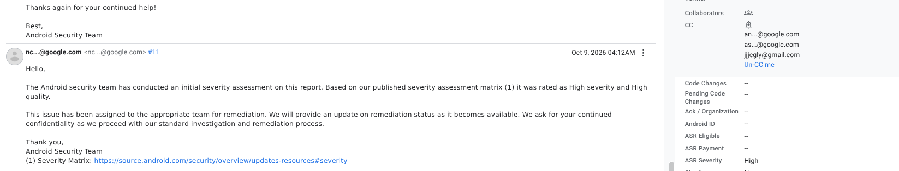
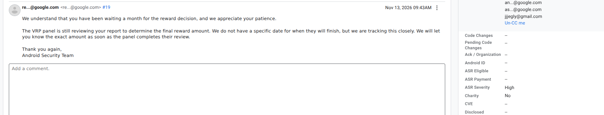

  

I've carried out independent security research for a number of vendors and OEMs, identifying vulnerabilities that have resulted in several CVEs. I've also worked directly with various vendors and manufacturers on security research and vulnerability disclosures.

 FYI I'm not against Google..
One of my own projects, Box, started as a fork of their AI Edge Gallery, and I've worked on it most days for the past year. Google has pulled features from my fork back into their project, so it has gone both ways, This is specifically about what happened when I reported real, working security bugs through their own process over a period of 12 months: they used the work, and they didn't pay for it..
I also maintain Iris which is a hardened Chromium fork focused on Modern day security and privacy, so as you can see i work on several google related projects.

For most of the last year this is what I've done. I reverse engineered the Samsung radio stack (under embargo), the IMS and RTP media code, the Trusty trusted apps, the MediaTek M90 modem RIL, and the Android telephony framework on Google's current phones, and many many more things. I filed ninety five reports through the Android and Google Devices Vulnerability Reward Program. 95% had a working proof of concept. 

Total paid, for all of it: **$250USD. One payment.**

This isn't one unlucky ticket. The same thing keeps happening three different ways.

**They fixed my bugs after closing them.** I pulled each closed report's binary out of Google's current factory image and diffed the exact function the report named. Eight of them had been fixed in shipped code: a bounds check, a permission, a validation step added exactly where I said it was missing. Every one of those eight was first closed as a "duplicate" or "not a vulnerability." None was paid. None was credited. Two more have since been fixed on the QPR3 beta.

**They closed bugs with reasons the code contradicts.** More than a dozen others were closed duplicate, infeasible, or "can't reproduce," and the exact defect is still sitting unchanged in the current build. Nobody owes a reward for an unfixed bug, and I'm not claiming one. The point is narrower: the stated reason for closing them does not survive a look at the actual binary.

**They promised a reward in writing, in January, and still haven't paid it.** Google confirmed a valid bug, raised the severity, raised the reward, in writing. Three months later they reversed all three with no new evidence. Then they said they would "stand by our word" and pay it anyway as a $250 "discretionary payment exception." That was January. Ten months of "processing / soon / no date" later, it still isn't paid,but was submitted prior to December 2025.

One line from that thread I still can't parse. They told me, in writing, that they are paying the Safety Center reward *"even though our final technical assessment rated it as a duplicate of a report with no security impact."* If it has no security impact there is no basis to pay it. If it is worth paying, "no security impact" is false. Both are in the ticket.

## Where this stands right now

- **$250, Safety Center report (Moderate).** Approved in writing in January, reconfirmed in writing several times since. Unpaid ten months later. Ticket closed...
- **Two High severity reports, still "Assigned."** Both formally rated High by Google. Rewards undetermined, CVEs awaiting to be assigned. One of the two has already been fixed **three times** in shipped code: first in the QPR3 beta (DP11.261002.005) in October, then in the **public November stable** (CP4A.261105.040.D1, rolled out to all Pixels on 2026-11-10), and again in the latest QPR3 beta (DP11.261030.003, released 12 November 2026), and the ticket is STILL "Assigned" with the reward field blank.. ?!?!? 
- **One Moderate report, still "Assigned."** Rated Moderate on 28 October. Reward undetermined.
- **Ten findings fixed after closure.** Closed as duplicate, infeasible, or not-a-vulnerability, then fixed in shipped code. No reward, no credit.. !?
- **Total actually received across all of it: $250..**

Everything in the tables below is a **closed** report, with Google's own words quoted from the tracker. The three still "Assigned" reports and anything under active coordinated disclosure are kept out of the technical detail on purpose.

## How I checked

Same method for every closed report in the tables:

1. Pull the exact binary, library, or jar the report named, out of Google's current factory image (rango and yogi Pixel builds, September and October 2026).
2. Extract it with the right tool for the container: `debugfs` for ext4, `fsck.erofs` for EROFS, a second pass through `apex_payload.img` for APEX modules.
3. Find the exact function the report cited. Symbol resolution where symbols survive, byte pattern matching against the report's own quoted disassembly where they don't.
4. Diff the current shipped code against what the report called vulnerable, using the NDK `llvm-objdump`. (The system binutils has no AArch64 backend and returns nothing without an error, which is worth knowing before you trust an empty diff.)

Verdicts are **PATCHED** (a check was added that wasn't there when I reported it), **STILL PRESENT** (code unchanged), **N/A** (reported against this exact build, or Google called it intended design), and **CANT-DETERMINE** (binary absent or build mismatch).

I didn't use Google's bulletin or supplemental patch list for this. A silent fix with no bulletin entry and no credit doesn't appear there by definition. You have to diff the shipped code, which is what this is..

## The reward they promised in writing and still haven't paid

On ticket **467575499 / 470814942**, on **23 January 2026**, Google wrote that they had "confirmed this is a valid bug," were "increasing severity," "increasing reward," and would "issue a payment for the new amount once it has been processed." On **24 April**, with no new analysis, they reversed all three. The same bug now "does not qualify for a reward or severity increase," called a "Final Assessment."

In June they wrote that they wanted to "stand by our word regarding the reward." On **10 July** they gave the numbers: "$250 for Safety Center, $250 for the mic bug, $500USD total," and said they were "honoring our initial promise," while still calling the Safety Center half a duplicate with no security impact. The mic half was paid. The Safety Center half went into a "discretionary payment exception" with, in their words, no "exact credit date." That was January. The most recent reply, in October, says the same thing: still approved, no date.

 <em>23 Jan 2026: "confirmed this is a valid bug," severity increased, reward increased, "we will issue a payment for the new amount once it has been processed."</em>

 <em>24 Apr 2026: all three reversed with no new analysis. The same report now "does not qualify for a reward or a severity increase." Labelled a "Final Assessment."</em>

 <em>9 Jul 2026: paying it anyway "even though our final technical assessment rated it as a duplicate of a report with no security impact."</em>

 <em>10 Jul 2026: the numbers, in writing. $250 + $250, $500 total. The Safety Center half put into a "discretionary payment exception" with no "exact credit date." Sidebar: ASR Payment 250.</em>

 <em>31 Oct 2026: still no date, no Bugcrowd reference. "your $250 reward is fully approved." And: "We also respect your right to publish a public write-up about your findings and your experience."</em>

## Rated High by Google, fixed in shipped code, reward field still blank

Not everything here is a duplicate or a "not a vulnerability." On this one Google's own panel rated the report **High severity, High quality**, assigned it for remediation, and the fix has since shipped three times: first in the QPR3 beta (DP11.261002.005) in October, then in the public November stable build (CP4A.261105.040.D1), and again in the latest QPR3 beta (DP11.261030.003). It is still marked "Assigned," with the reward and CVE fields left blank, so the vulnerability itself is kept out of this write-up. What the screenshots below show is only the process: a report Google rated High, confirmed reward-eligible in writing, then parked on "Assigned" after the exact gate it set had already been met.

 <em>7 Oct 2026: rated High severity, High quality. Sidebar: ASR Severity High, while ASR Eligible, ASR Payment and CVE are all blank.</em>

 <em>31 Oct 2026: "yes, your report is eligible for a reward." The amount is "still reviewing"; the ASR fields stay blank.</em>

 <em>4 Nov 2026: the gate, in their words. The ticket stays "Assigned" and the CVE is assigned "once the stable update is available to the public" and they confirm "the change you found in the beta is indeed the fix."</em>

 <em>13 Nov 2026: the stable update is now public, so the gate is met. The reply moves it: the fix is now "being scheduled for a future Pixel Update Bulletin," and the reward is "still reviewing." ASR fields still blank.</em>

And it is not the only one. A second, independent report was rated **High severity, High quality** by the same panel. A month later it is still "Assigned," the reward still "with the panel," the ASR fields still blank. The report is kept unnamed here and no technical detail is shown; the screenshots are only the rating and the reward state.

 <em>A second, separate report, independently rated High severity, High quality. Sidebar: ASR Severity High, while ASR Eligible, ASR Payment and CVE are all blank.</em>

 <em>Over a month later, on the same report: "you have been waiting a month for the reward decision." Still "with the panel," no date given, ASR fields still blank.</em>

## The duplicate-ID collision they admitted

Google closes a report as a duplicate against an internal canonical bug ID. I asked for the specific IDs behind several of mine. They gave the **same internal ID, 479203197**, as the original for two unrelated bugs: a Rust keystore panic in a trusted app, and a C++ out-of-bounds read in the RTP media parser. Different languages, different subsystems, different teams. One internal report is not the root cause of both.

They admitted it in writing, on both tickets: "Giving you this ID for your other report was a mistake on our end," and separately, "we made a mistake when linking the duplicate tickets." So at least one "verified duplicate" was stamped without anyone checking it against the report it named.

## The duplicates that appear months later, against reports I can't see

A lot of my reports followed the same arc. Filed, Assigned, worked by an engineer, and then months later, with no new technical comment in between, the status quietly flips to Duplicate. The reason is always an internal canonical bug ID I cannot view, usually with a line that it was "previously reported by an internal Google engineer." I have no way to see that internal report, confirm it exists, or confirm it actually predates mine.

And there are a lot of them. Of the 95 reports in my tracker, 34 were closed as Duplicate. A few of those are my own resubmissions and appeals collapsed back together, so call it roughly 26 distinct findings that Google agreed were real and then attributed to a report I am not allowed to see. A duplicate is not a rejection. It is Google confirming the bug exists and saying someone got there first. For 26 of mine, "someone" is an internal engineer who, by their account, found the identical bug the same month I did, against firmware that had only just shipped.

The timing is what I keep coming back to. I always work on the current month's latest factory image, so every report I file is against firmware that was released that same month, often only days before. A bug I pulled out of an image that shipped last week, coming back weeks later as something Google has supposedly had open internally for months, is a claim I am in no position to check, and it happens over and over.

In the one case where I pushed hard enough to get the canonical's build, it was at least plausible. 549662989 was deduped to a report filed against a Pixel 10 (blazer:16/CP1A.260505.005), and PixelModemService ships that same code on both generations, so I accepted it. But that is the exception. The collision above is what the process looks like the moment I can actually check it: the same internal ID handed out as the "original" for two completely unrelated bugs, admitted in writing as a mistake. If one "verified duplicate" was stamped without anyone matching it to the report it named, I have no reason to assume the two dozen others I cannot verify were handled any more carefully.

Here too, the canonical is a ticket I cannot open. Google says my re-file of the DCMO `DcmoReceiver` bug (585012607) duplicates 545652324, which they describe as filed on 12 August 2026 by another external researcher with the same root cause. I have no way to confirm any of that: 545652324 returns "Access denied," the same as every other canonical I have been pointed at, so the date, the author, and the root-cause match are Google's word and nothing I can check. What I can check is the code, and the defect is still present and unpatched in CP4A.261105.040.D1, months after the date they give for the original.

## The "not a vulnerability" template, used before and retracted again and again and then patched with the code i submitted.

Earlier in this, Google closed a finding with the standard "not a security vulnerability, logged for potential remediation in a future version, considered closed." They later took it back in writing: "You are completely correct. This finding is indeed a legitimate security vulnerability. It was incorrectly closed as 'not a security vulnerability' due to an oversight during triage of this specific ticket." The same template closed several more of my bugs after that. It has a record, on my own tickets, of being wrong by their own admission not just once or twice either, highly suspicious...

## Closed "Intended Behavior" by the "rate-limit bot"

From here on, after Google closes one of my reports I disclose it here. Both reports below hit the same variant, and it is worth being precise about who did what. Each report had already been assigned and triaged. Then a Google triager manually re-routed it back to "New," and one minute later, **from that same human account**, posted a message that labels itself "an automatically generated message" from the "Google Security Bot", closing the report **Won't Fix (Intended Behavior)** as a rate limit, and stating "we will not be able to see any of your responses." The genuinely automated messages on my tickets come from a separate system account; these came from the person who had just handled the ticket by hand a minute earlier, which is hard to square with an automated rate-limiter. On the second report, that close landed even after I had provided a full on-device reproduction on a locked, release-keys phone. Both defects are verifiable straight from the shipping image.

| Ticket | What it does | Closure |
|---|---|---|
| 560456349 | A zero-permission app controls the Pixel 11 carrier-satellite (NTN) stack. Two exported `SatelliteGateway` receivers with no permission let any app force satellite sessions and churn gateway auth-keys. `ITelephony` transaction 420 (`overrideCarrierRoamingNtnEligibilityChanged`) carries no permission check, while all ~30 sibling methods enforce, gated only by a fail-open mock-modem default that ships `true` (the only `true` of 11 such checks; AOSP defaults false), which lets the app pin or spoof the "carrier satellite available" signal until reboot. Missing-authorization, Moderate. | Assigned 12 Sep 2026; "currently reviewing the technical details" on 16 Sep; then on 14 Nov re-routed to "New" and closed **Won't Fix (Intended Behavior)**, posted as an "automated" rate limit from the same triager account that routed it a minute earlier, with no technical assessment. |
| 585028881 (re-file of 561846309) | A zero-permission app installs a forged but genuinely **Google-signed** platform config across all 8 `ConfigUpdater` surfaces (the emergency-number DB, telephony/satellite config, intent-firewall rules, the SMS short-code list, the carrier-ID DB, and the three TextClassifier models), live and persistent across reboot. **Defect A:** the config signature isn't bound to update-type. `PhenotypeHelper.getCertificate()` returns one cert for every type while its sibling `getContentUrl()` switches on type, so one blob Google signed for one type verifies for all eight (CWE-347), proven offline against the real production signing cert (serial `0xcb320d3f85c0cbaf`). **Defect B:** a `cts_test_` version-skip hook with no build gate. `shouldSkipVersionCheck()` keys only on a `file://` scheme plus a `cts_test_` basename, so it fires on production user builds (CWE-1220/489). Reproduced on a locked, release-keys Pixel 6a: a zero-permission app overwrote the live satellite config and it persisted across reboot. High integrity, still unpatched in CP4A.261105.040.D1. | First filed as 561846309 (closed WAI). Re-filed 12 Nov 2026 with a full on-device reproduction, assigned and CLA'd, then on 17 Nov re-routed to "New" and closed **Won't Fix (Intended Behavior)** one minute later, the same "automated" rate-limit message, from the same triager account that had just routed it, and the same close it got the first time, now after the reproduction was in hand. |

## A zero-click SMS RCE chain in the radio daemon, closed "not a security vulnerability"

Ticket 559521028. The MediaTek RIL on the Pixel 11 (`libmtkmipc-ril.so`, loaded by `mtkfusionrild`) re-implements the AOSP SMS, WAP-push and 3GPP2 parsers in native C++ but kept the AOSP style of unchecked `buf[i]` indexing. In Java an over-read throws and a try/catch swallows it. In native code there is no exception, so an over-read is a leak and an over-write is memory corruption.

Two defects, both reachable zero-click from a single inbound SMS, no user interaction, no app on the device:

- **Defect A, an exfiltratable heap over-read.** `PduParser::getAddress` and `constructUserData` take a copy length straight from an attacker-controlled PDU length byte (the TP-OA length, or TP-UDL set to 0xFF) with no check against the real buffer size, reading up to about 255 bytes past the PDU buffer. The over-read bytes are copied into the parsed message and forwarded up, so a remote sender reads rild heap memory back out of the delivered message, the notification, or the delivery report. That leaks heap and library pointers and defeats rild's ASLR, and `mtkfusionrild` is not MTE-instrumented on this build (BTI and PAC only), so the read is not tag-trapped.
- **Defect B, an attacker-controlled out-of-bounds write.** `BearerData::specialProcessForCtWapPush` masks its output cursor with `& 0xffff` but never bounds it against the 255-byte destination, and one branch uses a raw attacker byte as the `memcpy` length. A crafted 3GPP2 bearer-data message drives the write past the buffer with attacker content.

Leak to defeat ASLR, then write to corrupt a chosen object: the standard composition into remote code execution in rild, the radio daemon, which runs as the radio user and holds the direct channel to the baseband.

The reachability is the part I was most concrete about. The RIL does have one PDU sanity check, `smsDeliverPduCheck`, but it sits only on the branch that forwards the raw PDU to the framework. The native parser is reached through a separate path, `dispatchSms` to `onHandleSmsMessage` to `dispatchSuplMsg` to `SmsMessage::createFromPdu`, with no check on it at all. The SUPL gate that path depends on, `doesSuplExist()`, returns true for the entire lifetime of rild on any normal device: its global initializes to 2 in `.data` (confirmed in the shipped binary) and moves to 1 the moment MediaTek's location daemon is running. So the unchecked parser runs for every inbound SMS, and the trigger can be a silent Type 0 SMS the victim never sees.

I re-verified both defects unchanged in three shipped builds: the October stable (CD1A.261005.003), the November stable (CP4A.261105.040.D1, SPL 2026-11-05), and the DP11 QPR3 beta. No bounds check was added on any of these paths.

This is static analysis from the shipped binary. I do not have a modem test rig, which the report states plainly, so no runtime exploit is attached. On 12 November the team asked for a live software PoC. Two days later, on 14 November, the report was closed Won't Fix (Infeasible) with the template "we have investigated this issue and determined that this is not a security vulnerability... logged for potential remediation in a future version," and the ASR Severity field was set to NSBC. That is the same template this page documents Google retracting elsewhere, applied here to an unchecked, attacker-controlled `memcpy` length in the radio daemon, reachable zero-click, still present in the shipping build.

## Fixed in shipped code, closed with no reward

Every row is a closed report, diffed against Google's current factory image. "Fixed" means the code the report described changed: the report was right, the fix shipped, the ticket stayed closed, nothing was paid.

| Ticket | Component / function | Closure | Verdict |
|---|---|---|---|
| 549662989 | PixelModemService `MintReceiver` guard permission | Duplicate | Fixed. `MINT_CONFIGURATION_UPDATE_BROADCAST` now defined, signature\|privileged. |
| 538369053 | framework.jar `PduParser.parseParts` | Duplicate ("internal Google engineer") | Fixed. Bounds check against `stream.available()` added before the allocation. |
| 560866996 | framework.jar `PduParser` (same defect) | Duplicate, "internal Google engineer" | Fixed, same change as 538369053. |
| 545948346 | libpixelimsmedia.so `numberOfReportBlocks` | Duplicate, "internal Google engineer" | Fixed. Underflow check added before the division. |
| 540755547 | libpixelimsmedia.so `decodeRtcpChunk` | Duplicate | Fixed. Bounds check on the SDES item length before the copy. |
| 541096815 | libpixelimsmedia.so `DecodeRtpHeaderExtension` | Infeasible, "not a security vulnerability" | Fixed. Length byte now read unsigned, new bounds check after it. |
| 540753210 | libpixelimsmedia.so `decodeRtcpFbPacket` | Duplicate | Fixed. Length check added before the op that underflowed. |
| 529518244 | ShannonRcs.apk `DeviceProvisioningService` | Duplicate | Fixed. Now requires a signature\|privileged permission where it had none. |

Eight tickets, closed duplicate or infeasible, fixed in the shipping image. I re-checked all eight in the October builds and the fixes are still there.

Two more are fixed on the QPR3 beta (DP11.261002.005) and not yet on stable:

| Ticket | Component / function | Closure | Verdict |
|---|---|---|---|
| 555981160 | telephony-common.jar `ValueParser.retrieveItemsIconId` | Can't Repro | Fixed on QPR3 beta: a `length < 1` guard added before the array allocation. Still unchanged on the current stable image. |
| 538367541 / 543174762 | telephony-common.jar `WapPushOverSms.decodeWapPdu` | Duplicate | Fixed on QPR3 beta: a bounds check (`decodedDataLength + value <= buffer length`) added before the allocation. Still unchanged on stable. |

## The WAP-push bug just went public

On 30 October 2026 a researcher independently disclosed a zero-click WAP-push crash in Android's telephony stack (smsofdeath.com), written up here: https://cybersecuritynews.com/zero-click-android-vulnerability/ . A single malformed WAP-push SMS makes `WapPushOverSms.decodeWapPdu` allocate an array from an unvalidated, truncated header length, throwing an uncaught `NegativeArraySizeException` that kills the telephony process; the carrier's redelivery of the unacknowledged message turns one SMS into a repeating outage.

I reported that exact defect twice, with the `WspTypeDecoder`/`WapPushOverSms` root cause traced frame by frame and an executed proof against the shipped decoder:

- Issue 538367541, filed 24 July 2026, https://issuetracker.google.com/issues/538367541
- Issue 543174762, filed 6 August 2026, https://issuetracker.google.com/issues/543174762

Both were closed Duplicate of internal report 517376969, which Google says its internal automated testing filed in late May 2026. The fix, a bounds check before the allocation, shipped in the QPR3 beta (`DP11.261002.005`) and is still absent from the current stable build. On 30 October 2026 Google told me on the record that because the internal tool found it first, my reports are "not eligible for a reward."

So this one followed the whole pattern in a single pair of tickets: reported early, source-verified, closed duplicate, silently fixed in a later build, now independently public, and unpaid.

## The fix is in the build before the report is resolved

The clearest way to see it is two factory images side by side at the same patch level. The WAP-push crash (538367541 / 543174762, closed Duplicate) and the SIM Toolkit crash (555981160, closed "not reproducible," later corrected to Duplicate). Both closed. Neither paid.

Same file, same security patch level, two builds:

- Stable, google/yogi/yogi:17/CD1A.261005.003 (2026-10-05): still unguarded, exactly as reported.
- QPR3 beta, google/yogi_beta/yogi:17/DP11.261002.005 (same patch level): the guard the report asked for is already there. For the WAP-push bug, a bounds check before the allocation. For the SIM Toolkit bug, a `length < 1` check before it.

Run the diff yourself:

    jadx -d out telephony-common.jar

The bug was real enough to fix. The fix is in a shipping build. The report that found it and described that exact fix was closed as a duplicate or a non-issue and paid nothing, credited instead to an internal report I am not allowed to see, filed on a date I cannot verify, against firmware that had only just shipped.

## Still unpatched, closed with reasoning that doesn't hold

This is not a payment claim. None of these were fixed, It shows the stated closure reason doesn't match the code: the defect is still there, unchanged, in the current factory image. Every row is a closed report.

| Ticket | Component / function | Closure | Verdict |
|---|---|---|---|
| 561846309 | ConfigUpdater.apk `PhenotypeHelper.getCertificate()` | WAI | Unchanged. Returns one certificate for every config type while its sibling methods switch on type. |
| 552305734 | CrossDeviceAccessServicePrimary.apk `PermissionBroadcastReceiver` | Infeasible | Unchanged. Exported, no permission. |
| 558478942 (re-filed 585012607) | DCMO.apk `DcmoReceiver` | Duplicate | Unchanged. Exported, no permission, fail-open `isVerizon()` carrier gate (empty operator && empty IMSI returns true, so a bogus subscription id passes it). Re-filed 12 Nov 2026 after re-verifying it in CP4A.261105.040.D1; re-closed Duplicate of 545652324, a report I can't see. |
| 557568085 | TelephonyProvider.apk `updateSynchronized()` | Duplicate | Unchanged. Caller-supplied selection concatenated with no parentheses before the ownership clause. |
| 555984702 | grilservice.apk `RadioConfig.readFromParcel` | Can't Repro | Unchanged. Raw `readInt()` size used as an allocation, no upper bound. |
| 552188030 | services.jar `Vpn.setVpnForcedLocked()` | Duplicate | Unchanged. UID 0 excluded from the VPN lockdown range. |
| 558472707 | service-npumanager.jar `cancelModelLoad` | Infeasible | Unchanged. No caller-identity check, unlike sibling methods on the same class. |
| 537920968 | nfc_nci.st21nfc.default.so `handlePollingLoopData` | Infeasible | Unchanged. Same undersized length-check logic at the function's new address. |
| 538311587 | android.hardware.secure_element-service.uicc | Infeasible | Unchanged. Same mutex/slot/type offsets, no per-call correlation token. |
| 538314136 | IntentResolver.apk `UriMetadataReaderImpl.getMetadata` | Infeasible | Unchanged. No ownership check on the cross-profile URI read, after a refactor. |
| 561843639 | libmtkmipc-ril.so `handleUssdInd` | (reply only) | Unchanged, recompiled only. Wrong TLV length still used as the copy length. |
| 529102332 | ShannonRcs.apk `DebugBroadcastReceiver` | Duplicate | Unchanged. Exported, no permission. |
| 541986810 | framework.jar `RecoverySystem.verifyPackage` | Duplicate | Unchanged. The certificate checked and the certificate used for verification can still differ. |
| 547481980 | services.jar `FileService.enqueueOperation` | Duplicate | Unchanged (high confidence). No ownership or permission check before dispatch. |

## Count

- Fixed in shipped code, no reward or credit: eight on stable, two on the QPR3 beta. Ten, each its own ticket...
- Still present, closed with reasoning the code contradicts: the tickets above, plus more Samsung and MediaTek submissions through the same program.
- Could not be determined: a few where a build or device mismatch, a missing partition, or a stripped binary made the diff unreliable. Marked as such, not guessed...

## It isn't only me

In June 2026 The Register covered Justin O'Leary and his "ConfigConfusion" flaw in Google Config Connector, where a user in one Kubernetes namespace could reach GCP organization-owner rights. Google replied "Nice catch!", rated it P1/S1 and accepted, then reversed to "working as intended," denied the bounty, and left it unpatched with the tracker still showing it accepted. Acknowledged, then denied, still unfixed...

CSO Online covered the broader pattern in 2020 (J.M. Porup, *"Bug bounty platforms buy researcher silence, violate labor laws, critics say"*): critics, including legal scholars such as Amit Elazari and Katie Moussouris, argue these programs can be used to suppress disclosure, that researchers often have no legal safe harbor, and that the model raises labor-law questions. The "disposable contractor whose finished work gets rejected with no recourse" framing is mine, not theirs.
