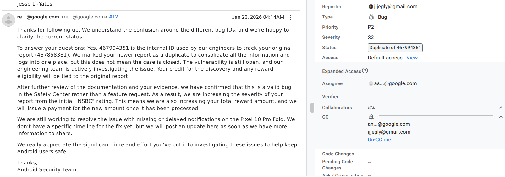
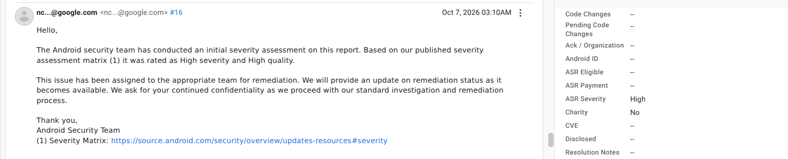
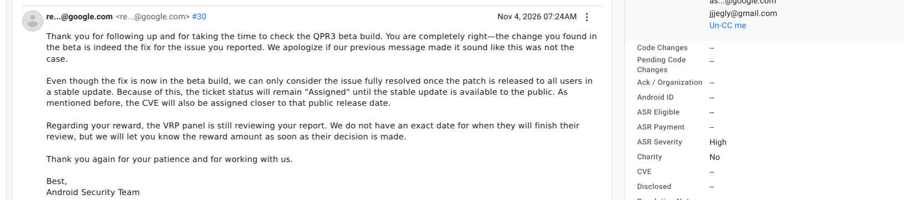

  

I am an independent security researcher. Over the years I have identified and responsibly disclosed vulnerabilities to a range of vendors and manufacturers, a number of which have been assigned CVE identifiers.

For the greater part of the past year my attention has rested on Google's current-generation Pixel devices. The work has entailed reverse engineering a good deal of the platform: the Samsung radio stack (presently under embargo), the IMS and RTP media handling, the Trusty trusted applications, the MediaTek M90 modem RIL and the Android telephony framework, among other quarters. Over that period I submitted ninety-five vulnerability reports to Google's Android and Google Devices Vulnerability Reward Programs, some ninety-five per cent of them accompanied by a working proof of concept.

**In total, the programme has paid me $250 USD, in a single payment.**

Let me say plainly at the outset that I bear Google no ill will. My own project, Box, began as a fork of their AI Edge Gallery; I have worked on it most days for a year, and Google have in turn drawn features from my fork back into their own. I also maintain Iris, a hardened fork of Chromium. A great deal of what I do rests on Google's work. This page concerns one thing only: what became of the security bugs I reported, in good faith, through their programme across twelve months.

The same failure recurred in three forms.

**Bugs were repaired after they had been closed.** For each closed report I drew the relevant binary from Google's current factory image and set the precise function the report named against it. Eight had been quietly repaired in shipped code: a bounds check, a permission or a validation step introduced at exactly the point I had marked as missing. Every one of the eight had first been closed as a "duplicate" or as "not a vulnerability". None was paid for, and none acknowledged. Two further findings have since been repaired in the QPR3 beta.

**Bugs were closed on grounds the code does not bear out.** More than a dozen others were closed as duplicate, infeasible or "can't reproduce", and the defect still sits unaltered in the current build. Nobody is owed a reward for an unfixed bug. The grounds given for closing these, however, do not survive an examination of the binary.

**A reward promised in writing remains unpaid.** In January, Google confirmed a valid bug and raised both its severity and its reward, in writing. Three months on they reversed the whole of it, upon no fresh evidence. They then undertook to "stand by our word" and to pay the $250 regardless, as a "discretionary payment exception". That was in January. Ten months of "processing", "soon" and "no date" later, it remains unpaid. The report itself was lodged before December 2025.

One sentence from that exchange I have never managed to parse. Google told me, in writing, that they were paying the Safety Center reward *"even though our final technical assessment rated it as a duplicate of a report with no security impact."* If the bug carried no security impact, there is nothing to pay for; if it merits payment, then it carried impact. Both propositions sit in the same ticket.

## The numbers

A brief reckoning before the detail. The rows overlap by their nature, a report closed as a duplicate may equally be one later repaired in shipped code, so they do not form a tidy partition of the ninety-five. They convey its shape.

| Outcome | |
|---|---|
| Reports filed to the Android and Google Devices VRP | 95 |
| Filed with a working proof of concept | ~95% |
| Paid | 1, for $250 USD |
| Still open, marked "Assigned" | 10 |
| Closed as a duplicate of an internal report I cannot view | 34 |
| Repaired in shipped code after closure, unpaid and uncredited | 10 |
| Closed infeasible, can't-reproduce or working-as-intended, yet still present in the current build | 14 |

I set the thirty-four duplicates aside on their own terms. A duplicate is Google agreeing that the bug is real and asserting that another reached it first, against a ticket I am not permitted to open; there is accordingly nothing in it I can examine, and nothing here rests upon it. All that follows is drawn from the remainder, where the shipped binary may simply be read.

## Where things stand

- **$250 USD Safety Center reward (Moderate).** Approved in writing in January and reaffirmed in writing on several occasions since. Ten months on it remains unpaid, and the ticket has been closed.
- **Two High severity reports, still "Assigned".** Google formally rated both as High. Neither has yet received a reward determination or a CVE. One of the two has already been repaired in shipped code three times over: in the QPR3 beta (DP11.261002.005) in October, in the **public November stable release** (CP4A.261105.040.D1, delivered to all Pixels on 10 November 2026), and again in the latest QPR3 beta (DP11.261030.003, of 12 November 2026). The ticket remains "Assigned", the reward field still empty.
- **One Moderate report, still "Assigned".** Rated Moderate on 28 October. No reward determination.
- **Ten findings repaired after closure.** Each was closed as a duplicate, infeasible or not a vulnerability, and later repaired in shipped code. Neither reward nor credit for any of them.
- **Total received: $250 USD.**

Everything in the tables below is a **closed** report, and Google's wording is quoted directly from the issue tracker. I have deliberately withheld the technical particulars of the three reports that remain "Assigned", together with anything under active coordinated disclosure.

Every report on this page is a closed ticket. Google's own position, as stated on these tickets, is that they neither grant nor deny permission to disclose, and that researchers are free to publish at their discretion. Nothing still under assessment, or under active coordinated disclosure, appears here.

## How I checked

I followed the same method for every closed report in the tables:

1. Draw the exact binary, library or jar named in the report from Google's current factory image (the rango and yogi Pixel builds of September and October 2026).
2. Unpack it with the tool proper to the container: `debugfs` for ext4, `fsck.erofs` for EROFS, and a second pass through `apex_payload.img` for APEX modules.
3. Locate the function the report cited, by its symbols where they survive and, where they do not, by matching the byte patterns against the disassembly the report itself quoted.
4. Set the shipped code against what the report had described as vulnerable, using the NDK's `llvm-objdump`. The system binutils carries no AArch64 backend and returns nothing without raising an error, which is worth knowing before one trusts an empty diff.

Each report was assigned one of four verdicts: **PATCHED** (a check now present that was absent when I reported it), **STILL PRESENT** (the code unchanged), **N/A** (reported against this very build, or described by Google as intended design) and **CANT-DETERMINE** (the binary absent, or the build a mismatch).

I did not lean on Google's security bulletins or the supplementary patch lists. A silent fix, carrying no bulletin entry and no credit, cannot appear there by definition; the only way to find one is to set the shipped code against itself, which is what this is.

## A reward promised in writing, still unpaid twelve months on

This concerns ticket **467575499 / 470814942**. On **23 January 2026** Google wrote that they had "confirmed this is a valid bug", were "increasing severity" and "increasing reward", and would "issue a payment for the new amount once it has been processed". On **24 April**, upon no further analysis, they reversed all three. Under the heading "Final Assessment", the same bug now "does not qualify for a reward or severity increase".

In June they wrote that they wished to "stand by our word regarding the reward". On **10 July** they set out the figures: "$250 for Safety Center, $250 for the mic bug, $500USD total", describing this as "honoring our initial promise", whilst still terming the Safety Center half a duplicate with no security impact. The microphone half was paid. The Safety Center half was consigned to a "discretionary payment exception" with, in their words, no "exact credit date". The most recent reply, in October, says much the same: still approved, still no date.

 <em>23 Jan 2026: "confirmed this is a valid bug", severity and reward both increased, and "we will issue a payment for the new amount once it has been processed".</em>

 <em>24 Apr 2026: all three reversed without further analysis. The same report now "does not qualify for a reward or a severity increase", under the heading "Final Assessment".</em>

 <em>9 Jul 2026: Google agree to pay regardless, "even though our final technical assessment rated it as a duplicate of a report with no security impact".</em>

 <em>10 Jul 2026: the figures in writing, $250 + $250, $500 in total. The Safety Center half is placed into a "discretionary payment exception" with no "exact credit date". The sidebar shows ASR Payment 250.</em>

 <em>31 Oct 2026: still no date and no Bugcrowd reference, although "your $250 reward is fully approved". The same message adds: "We also respect your right to publish a public write-up about your findings and your experience."</em>

## Rated High, fixed in shipped code, reward still blank

Not every report ended as a duplicate or a "not a vulnerability". Here Google's own panel rated the report **High severity, High quality**, and assigned it for remediation. The fix has since shipped three times over: in the QPR3 beta (DP11.261002.005) in October, in the public November stable build (CP4A.261105.040.D1), and in the latest QPR3 beta (DP11.261030.003). The ticket remains marked "Assigned", the reward and CVE fields still blank, so I have kept the vulnerability itself out of this account. The screenshots below show only the process: a report Google rated High and confirmed in writing as reward-eligible, then left upon "Assigned" after the very condition they had set was met.

 <em>7 Oct 2026: rated High severity, High quality. In the sidebar, ASR Severity reads High, whilst ASR Eligible, ASR Payment and CVE are all blank.</em>

 <em>31 Oct 2026: "yes, your report is eligible for a reward". The amount is "still reviewing" and the ASR fields remain blank.</em>

 <em>4 Nov 2026: the condition, in their words. The ticket stays "Assigned" and the CVE will be assigned "once the stable update is available to the public". They also confirm that "the change you found in the beta is indeed the fix".</em>

 <em>13 Nov 2026: the stable update is now public, so the condition has been met. The reply moves the goalposts: the fix is now "being scheduled for a future Pixel Update Bulletin" and the reward is "still reviewing". The ASR fields are still blank.</em>

Nor is it the only one. A second, unrelated report was likewise rated **High severity, High quality** by the same panel. A month on it is still "Assigned", the reward still "with the panel", the ASR fields still blank. I have neither named the report nor shown any technical detail; the screenshots give only the rating and the state of the reward.

 <em>A second, separate report, independently rated High severity, High quality. ASR Severity reads High, whilst ASR Eligible, ASR Payment and CVE are all blank.</em>

 <em>More than a month later, on the same report: "you have been waiting a month for the reward decision". Still "with the panel", no date given, and the ASR fields still blank.</em>

## The duplicate ID they admitted was wrong

When Google closes a report as a duplicate, it is closed against an internal "canonical" bug ID. I asked for the IDs behind several of mine. For two wholly unrelated bugs they gave me **the same internal ID, 479203197**: one a Rust keystore panic in a trusted application, the other a C++ out-of-bounds read in the RTP media parser. They are written in different languages, sit in different subsystems and belong to different teams. A single internal report cannot be the origin of both.

Google conceded as much in writing, on both tickets: "Giving you this ID for your other report was a mistake on our end," and, separately, "we made a mistake when linking the duplicate tickets." So at least one supposedly verified duplicate had been marked as such with no one having set it against the report it named.

## Duplicate claims I cannot verify, raised months later

A great many of my reports ran the same course. Filed, assigned, worked by an engineer, and then, months later and with no intervening technical comment, quietly altered to Duplicate. The original is invariably an internal ticket I cannot view, commonly accompanied by a note that it was "previously reported by an internal Google engineer". I have no means of seeing that report, of confirming that it exists, or of confirming that it predates mine.

There are a great many of these. Of the ninety-five reports I have filed, thirty-four were closed as duplicates. A handful are my own resubmissions and appeals folded back together, so it comes to roughly twenty-six distinct findings that Google accepted as real and then attributed to a report I am not permitted to see. A duplicate is not a rejection; it is Google confirming that the bug exists and asserting that another found it first. In twenty-six of my cases, that other was an internal engineer who, by Google's account, found the identical bug in the same month I did, in firmware only just released.

It is the timing I return to. I work always from the current month's factory image, so every report I file concerns firmware released that month, often only days before. When a bug I drew from an image that shipped last week returns weeks later as something Google has apparently held open internally for months, I am in no position to check it, and it happens again and again.

On the single occasion I pressed hard enough to learn which build the original had been filed against, the explanation was at least plausible. Report 549662989 was marked a duplicate of one filed against a Pixel 10 (blazer:16/CP1A.260505.005), and PixelModemService ships the same code on both generations, so I accepted it. That was the exception. The collision above shows what the process looks like the moment I can actually check it: the same internal ID handed out as the "original" for two entirely unrelated bugs, conceded in writing as a mistake. If one supposedly verified duplicate was marked with no one comparing it to the report it named, I have no reason to suppose the two dozen I cannot check were handled with any greater care.

The DCMO `DcmoReceiver` bug is a case in point. Google say my re-filed report (585012607) duplicates 545652324, which they describe as filed on 12 August 2026 by another external researcher, with the same root cause. I can confirm none of it. Opening 545652324 returns "Access denied", as has every other original I have been directed to, so the date, the author and the root cause are Google's word and nothing I can check. What I can check is the code, and the defect remains unpatched in CP4A.261105.040.D1, months after the date they give for the original.

## The "not a security vulnerability" template

Early on, Google closed one of my findings with their standard message: "not a security vulnerability, logged for potential remediation in a future version, considered closed". They afterwards withdrew it in writing: "You are completely correct. This finding is indeed a legitimate security vulnerability. It was incorrectly closed as 'not a security vulnerability' due to an oversight during triage of this specific ticket."

The same template has since served to close several more of my reports. On my own tickets alone it has been shown wrong more than once, by Google's own admission, and the issue thereafter patched with the very code I had submitted.

## Closed "Intended Behavior" by a "rate-limit bot"

From this point on, whenever Google closes one of my reports, I publish it here. The two reports below were closed in the same manner. Both had already been assigned and triaged. A Google triager then manually returned each to "New", and a minute later, **from that same personal account**, posted a message describing itself as "an automatically generated message" from the "Google Security Bot". The message closed the report as **Won't Fix (Intended Behavior)** on the grounds of a rate limit, and stated "we will not be able to see any of your responses".

The genuinely automated messages on my tickets issue from a separate system account. These came from the person who had handled the ticket by hand a minute before, which is difficult to reconcile with an automated rate limiter. The second report was closed in this way even after I had supplied a full reproduction on a locked, release-keys phone. Both defects may be verified directly from the shipping image.

| Ticket | What it does | Closure |
|---|---|---|
| 560456349 | An app with no permissions can control the Pixel 11's carrier satellite (NTN) stack. Two exported `SatelliteGateway` receivers have no permission, so any app can force satellite sessions and churn gateway auth keys. `ITelephony` transaction 420 (`overrideCarrierRoamingNtnEligibilityChanged`) has no permission check, although all ~30 of its sibling methods enforce one. Its only gate is a mock-modem default that fails open: it ships as `true`, the only one of 11 such checks to do so (AOSP defaults to false). This lets the app pin or spoof the "carrier satellite available" signal until the phone is rebooted. Missing authorisation, Moderate. | Assigned on 12 September 2026. On 16 September, "currently reviewing the technical details". On 14 November it was moved back to "New" and closed as **Won't Fix (Intended Behavior)**, with an "automated" rate-limit message posted from the same triager account that had moved it a minute earlier. No technical assessment was given. |
| 585028881 (re-file of 561846309) | An app with no permissions can install a forged but genuinely **Google-signed** platform config across all eight `ConfigUpdater` surfaces: the emergency number database, the telephony and satellite config, the intent firewall rules, the SMS short-code list, the carrier ID database and the three TextClassifier models. The change takes effect immediately and survives a reboot. **Defect A:** the config signature isn't tied to the update type. `PhenotypeHelper.getCertificate()` returns the same certificate for every type, whereas its sibling `getContentUrl()` switches on type, so a blob Google signed for one type verifies for all eight (CWE-347). I proved this offline against the real production signing certificate (serial `0xcb320d3f85c0cbaf`). **Defect B:** a `cts_test_` version-skip hook with no build gate. `shouldSkipVersionCheck()` checks only for a `file://` scheme and a `cts_test_` filename, so it also fires on production user builds (CWE-1220/489). Reproduced on a locked, release-keys Pixel 6a, where an app with no permissions overwrote the live satellite config and the change persisted across a reboot. High integrity impact, and still unpatched in CP4A.261105.040.D1. | First filed as 561846309 and closed as WAI. Re-filed on 12 November 2026 with a full on-device reproduction, then assigned and CLA'd. On 17 November it was moved back to "New" and closed as **Won't Fix (Intended Behavior)** a minute later, with the same "automated" rate-limit message from the same triager account. The same outcome as the first time, only now with the reproduction in hand. |

## A zero-click SMS remote code execution chain in the radio daemon, closed "not a security vulnerability"

This is ticket 559521028. The MediaTek RIL on the Pixel 11 (`libmtkmipc-ril.so`, loaded by `mtkfusionrild`) reimplements the AOSP SMS, WAP push and 3GPP2 parsers in native C++, yet retains AOSP's habit of indexing `buf[i]` without checking bounds. In Java, reading past the end of a buffer throws an exception that is caught; in native code nothing is thrown, so an over-read leaks memory and an over-write corrupts it.

There are two defects. Both are reachable from a single incoming SMS, with no user interaction and no app installed:

- **Defect A, a heap over-read that leaks data to the sender.** `PduParser::getAddress` and `constructUserData` take their copy length straight from a length byte in the PDU, which the attacker controls (the TP-OA length, or TP-UDL set to 0xFF). Neither checks it against the real buffer size, so both can read up to about 255 bytes beyond the end of the PDU buffer. Those bytes are copied into the parsed message and passed up the stack, so a remote sender can read rild's heap memory back out of the delivered message, the notification or the delivery report. That leaks heap and library pointers and defeats rild's ASLR. On this build `mtkfusionrild` is not instrumented with MTE (only BTI and PAC), so memory tagging does not catch the read.
- **Defect B, an out-of-bounds write the attacker controls.** `BearerData::specialProcessForCtWapPush` masks its output cursor with `& 0xffff` but never checks it against the 255-byte destination, and one branch uses a raw byte from the message as the `memcpy` length. A crafted 3GPP2 bearer data message drives the write past the end of the buffer with content of the attacker's choosing.

Use the leak to defeat ASLR, then the write to corrupt a chosen object: the standard route to remote code execution in rild, the radio daemon, which runs as the radio user and holds a direct channel to the baseband.

Reachability is the crux here, so I traced it exactly. The RIL does carry one sanity check on PDUs, `smsDeliverPduCheck`, but it sits only on the branch that forwards the raw PDU to the framework. The native parser is reached by a separate path, from `dispatchSms` to `onHandleSmsMessage` to `dispatchSuplMsg` to `SmsMessage::createFromPdu`, with no check upon it at all. That path turns on a SUPL gate, `doesSuplExist()`, which returns true for as long as rild runs on any ordinary device: its global initialises to 2 in `.data` (confirmed in the shipped binary) and moves to 1 the moment MediaTek's location daemon starts. The unchecked parser therefore runs on every incoming SMS, and the trigger may be a silent Type 0 SMS the user never sees.

I re-examined both defects across three shipped builds: the October stable release (CD1A.261005.003), the November stable release (CP4A.261105.040.D1, SPL 2026-11-05) and the DP11 QPR3 beta. No bounds check had been added on any of these paths.

This is static analysis of the shipped binary. I have no modem test rig, as the report states plainly, so no runtime exploit is attached. On 12 November the team asked for a live software proof of concept. Two days later, on 14 November, the report was closed Won't Fix (Infeasible) with the template "we have investigated this issue and determined that this is not a security vulnerability... logged for potential remediation in a future version", and the ASR Severity field was set to NSBC. That is the same template Google have already withdrawn on another of my reports, here applied to an unchecked, attacker-controlled `memcpy` length in the radio daemon, reachable with zero clicks and still present in the shipping build.

## Other closed bugs, in brief

A few more of the closed reports, kept short. Each gives the bug, roughly how it works, and how it is reached.

**An OTA update the device will install, signed by the wrong key (ticket 541986810, closed Duplicate).** `RecoverySystem.verifyPackage` is the check that decides whether an update package is really signed by Google. It looks at two certificates and never confirms they are the same one. The trust check looks at the certificate sitting first in the package. The signature is then verified against a different certificate, chosen by an issuer and serial number that are also read from the package. So an attacker puts Google's genuine, public signing certificate first to pass the trust check, puts their own certificate further in, points the signature at that one, and signs the package with their own key. The check passes for a package they signed. It is reached through the sideload or update path, where the signature gate that is supposed to stop an unofficial package does not.

**DNS still leaves the phone when you turn on "Block connections without VPN" (ticket 552188030, closed Duplicate).** VPN lockdown is meant to stop any traffic that is not inside the tunnel. DNS queries are left exempt from that block, for every app, not just the device's own traffic. So even with lockdown on, an app's DNS lookups leave the device outside the VPN, which leaks which sites are being resolved and gives a channel the lockdown is supposed to close.

**Any app can switch off your Lock-on-Disconnect (ticket 552305734, closed Infeasible, still present).** The Cross-Device stack exports a broadcast receiver, `PermissionBroadcastReceiver`, with no permission on it, and it acts on the broadcast without checking who sent it. Any installed app, holding no permissions, can send that broadcast and force an immediate un-enrollment of the user's Lock-on-Disconnect security feature, turning off a protection the user had switched on.

**The share sheet fetching a picture it should not (ticket 538314136, closed Infeasible, still present).** The intent resolver renders a caller-supplied icon URI without checking the caller is allowed to read it. An app hands it a URI that points at content belonging to another user or profile, and a privileged process fetches it on the attacker's behalf and hands it back.

**Any app cancelling another app's on-device AI model load (ticket 558472707, closed Infeasible, still present).** `cancelModelLoad` in the NPU manager service does not check who is calling, so any app can cancel a different app's model load and deny it the hardware AI path.

**A radio service you can crash with one value (ticket 555984702, closed Can't Reproduce, still present).** The `grilservice` radio-config path reads an array size straight from an incoming parcel with no cap and allocates it. A crafted size forces a huge allocation and takes the service down, dropping telephony.

**Any app can bind the Play Store's setup service (ticket 564059393, closed Working As Intended).** Play Store exports `IPlaySetupServiceV2`, and the permission meant to guard it declares no protection level, so Android treats it as a normal permission and auto-grants it to any app that asks. Any installed app can then bind the service. The same pattern, a guard permission with no protection level so it auto-grants, turned up across 31 exported components in the shipped image.

**An unprotected "setup finished" broadcast that rewrites your system locale (ticket 563958561, closed Infeasible).** `SETUP_WIZARD_FINISHED` is not a protected broadcast, so any app can send it. Nine privileged, system-UID receivers act on it, and one of them persistently rewrites the device's system locale. A zero-permission app sends one broadcast and changes a system-wide setting it has no right to touch.

**A preinstalled app slipping past the account-ownership check (ticket 559524832, closed Infeasible).** `AccountManagerService.isSystemUid()` actually tests whether the caller is preinstalled, not whether it is the system UID. Any preinstalled app therefore passes a guard meant only for the system, and can see and remove accounts it does not own.

**Faking that you are standing next to your car (ticket 560453159, closed Can't Reproduce).** Two chained UWB bugs: one leaks the secure-ranging session key, the other hijacks the Digital Key radio path. Together a zero-permission app could spoof the physical proximity that passive car entry relies on, without being anywhere near the vehicle.

**One Wi-Fi frame reading out of bounds in the kernel (ticket 568933934, closed Can't Reproduce).** An unsigned integer underflow in the Broadcom Wi-Fi driver's QoS-Map action-frame handler causes an out-of-bounds read in kernel heap memory. A single 25-byte 802.11 action frame from a nearby Wi-Fi peer triggers it, with no association or pairing.

**A VoLTE call message that hangs the IMS stack (ticket 560878423, closed Can't Reproduce).** A SIP message with a negative Content-Length is parsed as a signed value, the offset goes negative, and the receive loop never ends. One zero-click message puts the VoLTE/IMS stack into a permanent hang.

**Any app reading and tampering with your Now Playing history (ticket 562215877, closed Infeasible).** Private Compute Services exports `NowPlayingRelayService` as a binder with no caller check, unlike four sibling services in the same app. Any installed app can read and alter the record of music the phone has recognised around you.

**Any app triggering a recognition pass and reading the result (ticket 561838690, closed Infeasible).** The Android System Intelligence `MusicRelayService` binder does no caller check across its 19 transactions, so any app can read your Now Playing history and silently start a new recognition pass, listening to what is around you.

**An RCS suggestion that runs JavaScript in-app with one tap (ticket 572199671, closed Working As Intended).** Google Messages' blocklist for RCS suggested-action URLs misses the `javascript:` and `data:` schemes, so a crafted suggestion loads into a JavaScript-enabled bridged WebView, and one tap runs the attacker's JavaScript inside the app.

**Any app reading the CBRS radio database and its coordinates (ticket 579289116, closed Duplicate).** The `CbsdContentProvider` in SCONE is exported with no guard, so any installed app can read the CBRS CBSD database, including the CBSD location coordinates, that it should have no access to.

**A Wi-Fi attribute reading out of bounds in the kernel (ticket 547477982, closed Duplicate).** The Broadcom Wi-Fi driver does not validate a NAN SDEA attribute length before using it, so a crafted value causes an out-of-bounds read in kernel memory. It is reachable from a nearby Wi-Fi peer.

**A system service handed the keys to start anything (ticket 558470054, closed Infeasible).** `dcservice`, an app-tier component, is given the SELinux permission to start any init service, the only domain on the whole device with that broad grant, and for a capability its own code never uses. It is exactly the kind of over-grant that turns a small foothold into a larger one.

**The SDK sandbox taking attacker file paths (ticket 561840524, closed Can't Reproduce).** `computeSdkStorage` is the one method on the SDK Runtime sandbox service that is missing the check that the caller is the system server, so any zero-permission app can bind the service and call it with paths of its choosing.

**A two-byte location message that exhausts the stack (ticket 568936058, closed Can't Reproduce).** The GNSS daemon's SUPL message framing recurses into itself with no base case when a message declares a zero length, so a two-byte message drives it into infinite recursion and crashes the daemon.

**A WAP-push SMS that quietly kills texting (ticket 543183960, closed Infeasible).** A malformed WAP-push message lands in a loop with an empty catch block, so instead of failing cleanly the telephony process hangs and SMS silently stops working.

**A SIP message body that overflows a stack buffer (ticket 540746953, closed Duplicate).** The IMS SIP encoder copies a message body into a fixed 65535-byte array on the stack with no cap, so an oversized body overflows it.

**An eUICC update any app can kick off (ticket 532021672, closed Infeasible).** `StartOtaReceiver` is exported and unprotected, so any unprivileged app can trigger the eUICC OTA flow by sending the broadcast it listens for.

**A system app that fetches URLs for you (ticket 537921665, closed Working As Intended).** ConfigUpdater's exported receivers take a URL from broadcast extras and fetch it, with no checks, so an app with no INTERNET permission can make a system app perform requests on its behalf, a server-side request forgery.

**Tethered traffic walking straight past VPN lockdown (ticket 552196751, closed Infeasible).** "Block connections without VPN" does not cover tethered clients, so anything connected over USB, Ethernet or the Wi-Fi hotspot bypasses the VPN entirely. Google closed it as working by construction.

**Any app repainting the real enterprise-enrollment screen (ticket 552200665, closed Infeasible).** A zero-permission app can drive the phone's genuine enterprise-enrollment screen and place its own logo on it, on demand, which is the groundwork for a convincing enrollment phish.

**Impersonating another process by renaming yourself (ticket 559533853, closed Infeasible).** The process-monitor daemon identifies the process it watches only by reading `/proc/pid/cmdline`, with no UID check when the vendor config leaves the uid out. Any app can set its own process name to match the target and be treated as it.

**An NFC firmware-update reply read past its buffer (ticket 537923579, closed Duplicate).** The NFC firmware-update handler indexes into the response from the NFC chip using a length it does not check. It sits on the trust boundary with the physically attached NFC controller.

**Any app making a system installer install an APK (ticket 563677600, closed Duplicate).** WebAppService runs as a privileged app holding INSTALL_PACKAGES. By declaring a single intent-filter, any zero-permission app can make it install an APK, borrowing its install privilege.

**A CDMA text message that overflows the radio daemon's stack (ticket 568929629, closed Duplicate).** The MediaTek RIL's CDMA CT-WAP SMS decoder (`BearerData::specialProcessForCtWapPush`) writes past a fixed buffer on a crafted message, with no interaction. This is the write half of the SMS chain described above, filed on its own.

**A reported heap write in the Messages image decoder (ticket 537918512, closed Working As Intended).** A crafted animated-WebP image delivered by MMS or RCS, where the frame-disposal step in `libframesequence` was reported to clear a region using a width and height taken from the file without clamping them, overflowing the pixel buffer. Google closed it Working As Intended, and unlike most of the entries here I could not fully confirm the path in the shipped binary, so it is listed as reported and closed rather than verified.

## Fixed in shipped code, closed without a reward

Each row is a closed report, set against Google's current factory image. "Fixed" means the code the report described has changed: the report was right, the fix shipped, the ticket stayed closed, and nothing was paid.

| Ticket | Component / function | Closure | Verdict |
|---|---|---|---|
| 549662989 | PixelModemService `MintReceiver` guard permission | Duplicate | Fixed. `MINT_CONFIGURATION_UPDATE_BROADCAST` now defined, signature\|privileged. |
| 538369053 | framework.jar `PduParser.parseParts` | Duplicate ("internal Google engineer") | Fixed. Bounds check against `stream.available()` added before the allocation. |
| 560866996 | framework.jar `PduParser` (same defect) | Duplicate, "internal Google engineer" | Fixed, same change as 538369053. |
| 545948346 | libpixelimsmedia.so `numberOfReportBlocks` | Duplicate, "internal Google engineer" | Fixed. Underflow check added before the division. |
| 540755547 | libpixelimsmedia.so `decodeRtcpChunk` | Duplicate | Fixed. Bounds check on the SDES item length before the copy. |
| 541096815 | libpixelimsmedia.so `DecodeRtpHeaderExtension` | Infeasible, "not a security vulnerability" | Fixed. Length byte now read unsigned, new bounds check after it. |
| 540753210 | libpixelimsmedia.so `decodeRtcpFbPacket` | Duplicate | Fixed. Length check added before the op that underflowed. |
| 529518244 | ShannonRcs.apk `DeviceProvisioningService` | Duplicate | Fixed. Now requires a signature\|privileged permission where it had none. |

That is eight tickets, closed as duplicate or infeasible, repaired in the shipping image. I re-examined all eight against the October builds, and the fixes remain in place.

Two more have been repaired in the QPR3 beta (DP11.261002.005) and not yet in a stable release:

| Ticket | Component / function | Closure | Verdict |
|---|---|---|---|
| 555981160 | telephony-common.jar `ValueParser.retrieveItemsIconId` | Can't Repro | Fixed on QPR3 beta: a `length < 1` guard added before the array allocation. Still unchanged on the current stable image. |
| 538367541 / 543174762 | telephony-common.jar `WapPushOverSms.decodeWapPdu` | Duplicate | Fixed on QPR3 beta: a bounds check (`decodedDataLength + value <= buffer length`) added before the allocation. Still unchanged on stable. |

## Verifying this yourself

I have deliberately spared this page long stretches of disassembly, for a plain reason: every verdict names the file, the function and the change, which is enough for anyone to confirm it against the binary for themselves. The claims are exact because they are correct. All that is wanted beyond the function name is the two images under comparison, and Google publish a SHA-256 for every one of them.

These are the builds upon which the verdicts above rest, with the checksums taken from Google's own factory-image pages:

| Build | SHA-256 |
|---|---|
| yogi (Pixel 11 Pro Fold) · CD1A.260714.001.A9, Aug 2026 | `0c09a12ce9e64aac17b4389cc926beade475ca3b8b77008be8e0742444fefcf6` |
| yogi · CD1A.261005.003, Oct 2026 stable | `0f9fd538c4be6943421c85f55539000f519b1226db5e2ab9b95aa60d69759777` |
| yogi · CP4A.261105.040.D1, Nov 2026 stable | `80f03b7fd172cf35a7572b7a4c21d8533bd6b1adae3126e3d3065b66ca452797` |
| yogi_beta · DP11.261030.003, QPR3 beta | `72fd6286b33e43d13d30603fff1bee6613bdab178d9e51d27c4bb9398e76b30f` |
| rango (Pixel 10 Pro Fold) · CP2A.260705.006, Jul 2026 | `b36115712ba0c07132aca6270c780d70862e06f17810bdae2e27d55d56832955` |
| rango · CP3A.260905.009, Sep 2026 | `6b80e9d5984229611d231b8883695da81f6d631f0bcbbf7460f8276f6d815c4c` |
| rango · CP4A.261105.040.A1, Nov 2026 | `3fc4f4f23ca01be4ba6b57bec9bcb5df28c98af6e61438b80846e728af0e3f2a` |

To check any row in the tables above: take the two builds named, verify each download against its checksum, and extract the library or jar the report cites, `debugfs` for an ext4 partition, `fsck.erofs` for EROFS, and a second pass through `apex_payload.img` for an APEX module. For the native libraries, disassemble the named function in each build with the NDK's `llvm-objdump`; the system binutils carries no AArch64 backend and returns an empty result without raising an error, so it is the NDK build you want. For the Java and bytecode cases, `jadx` across the two copies of the jar. The before and the after sit exactly where the report said they would.

## The WAP push bug, now disclosed publicly

On 30 October 2026 another researcher independently disclosed a zero-click WAP push crash in Android's telephony stack (smsofdeath.com), reported here: https://cybersecuritynews.com/zero-click-android-vulnerability/ . A single malformed WAP push SMS leads `WapPushOverSms.decodeWapPdu` to allocate an array from an unvalidated, truncated header length. This throws an uncaught `NegativeArraySizeException` that kills the telephony process, and since the carrier keeps redelivering the unacknowledged message, one SMS becomes a recurring outage.

I reported that exact defect twice, the root cause in `WspTypeDecoder` and `WapPushOverSms` traced frame by frame, with a working proof against the shipped decoder:

- Issue 538367541, filed on 24 July 2026: https://issuetracker.google.com/issues/538367541
- Issue 543174762, filed on 6 August 2026: https://issuetracker.google.com/issues/543174762

Both were closed as duplicates of internal report 517376969, which Google say was filed by their internal automated testing in late May 2026. The fix, a bounds check before the allocation, shipped in the QPR3 beta (`DP11.261002.005`) and is still absent from the current stable build. On 30 October 2026 Google told me, on the record, that because their internal tool found it first my reports are "not eligible for a reward".

So this one pair of tickets runs the whole course: reported early, verified against the source, closed as a duplicate, repaired without comment in a later build, disclosed publicly by another, and never paid.

## The fix ships before the report is closed

The clearest way to see it is to set two factory images of the same patch level side by side. Take the WAP push crash (538367541 / 543174762, closed Duplicate) and the SIM Toolkit crash (555981160, closed "not reproducible" and later altered to Duplicate). Both closed. Neither paid.

The same file, at the same security patch level, in two builds:

- Stable, google/yogi/yogi:17/CD1A.261005.003 (2026-10-05): still unguarded, exactly as reported.
- QPR3 beta, google/yogi_beta/yogi:17/DP11.261002.005 (same patch level): the guard the report asked for is already present. For the WAP push bug, a bounds check before the allocation; for the SIM Toolkit bug, a `length < 1` check before it.

You may compare them for yourself:

    jadx -d out telephony-common.jar

The bug was real enough to fix, and the fix sits in a shipping build. Yet the report that found it, and described that very fix, was closed as a duplicate or a non-issue and paid nothing. The credit went instead to an internal report I am not permitted to see, filed on a date I cannot verify, against firmware only just released.

## Still unpatched, closed for reasons the code contradicts

None of the vulnerabilities in this section has been remediated. They are set down here because the reasons given for closing them are inconsistent with the source. Each defect remains present, unaltered and reproducible in the current factory firmware image, and each report was formally closed all the same.

| Ticket | Component / function | Closure | Verdict |
|---|---|---|---|
| 561846309 | ConfigUpdater.apk `PhenotypeHelper.getCertificate()` | WAI | Unchanged. Returns one certificate for every config type while its sibling methods switch on type. |
| 552305734 | CrossDeviceAccessServicePrimary.apk `PermissionBroadcastReceiver` | Infeasible | Unchanged. Exported, no permission. |
| 558478942 (re-filed 585012607) | DCMO.apk `DcmoReceiver` | Duplicate | Unchanged. Exported, no permission, fail-open `isVerizon()` carrier gate (empty operator && empty IMSI returns true, so a bogus subscription id passes it). Re-filed 12 Nov 2026 after re-verifying it in CP4A.261105.040.D1; re-closed Duplicate of 545652324, a report I can't see. |
| 557568085 | TelephonyProvider.apk `updateSynchronized()` | Duplicate | Unchanged. Caller-supplied selection concatenated with no parentheses before the ownership clause. |
| 555984702 | grilservice.apk `RadioConfig.readFromParcel` | Can't Repro | Unchanged. Raw `readInt()` size used as an allocation, no upper bound. |
| 552188030 | services.jar `Vpn.setVpnForcedLocked()` | Duplicate | Unchanged. UID 0 excluded from the VPN lockdown range. |
| 558472707 | service-npumanager.jar `cancelModelLoad` | Infeasible | Unchanged. No caller-identity check, unlike sibling methods on the same class. |
| 537920968 | nfc_nci.st21nfc.default.so `handlePollingLoopData` | Infeasible | Unchanged. Same undersized length-check logic at the function's new address. |
| 538311587 | android.hardware.secure_element-service.uicc | Infeasible | Unchanged. Same mutex/slot/type offsets, no per-call correlation token. |
| 538314136 | IntentResolver.apk `UriMetadataReaderImpl.getMetadata` | Infeasible | Unchanged. No ownership check on the cross-profile URI read, after a refactor. |
| 561843639 | libmtkmipc-ril.so `handleUssdInd` | (reply only) | Unchanged, recompiled only. Wrong TLV length still used as the copy length. |
| 529102332 | ShannonRcs.apk `DebugBroadcastReceiver` | Duplicate | Unchanged. Exported, no permission. |
| 541986810 | framework.jar `RecoverySystem.verifyPackage` | Duplicate | Unchanged. The certificate checked and the certificate used for verification can still differ. |
| 547481980 | services.jar `FileService.enqueueOperation` | Duplicate | Unchanged (high confidence). No ownership or permission check before dispatch. |

## In total

- Repaired in shipped code, with neither reward nor credit: eight in the stable release and two in the QPR3 beta. Ten in all, each its own ticket.
- Still present, having been closed for reasons the code contradicts: the tickets above, together with further Samsung and MediaTek reports submitted through the same programme.
- Undetermined: a handful where a build or device mismatch, a missing partition or a stripped binary rendered the comparison unreliable. These are marked as such rather than guessed.

## Similar cases

Comparable patterns have been set down by other security researchers taking part in Google's vulnerability disclosure programmes.

**Config Connector, 2026.** In June 2026 [The Register reported](https://www.theregister.com/security/2026/06/18/google-told-researcher-nice-catch-then-denied-bug-bounty-for-flaw-it-still-hasnt-fixed/5258076) on Justin O'Leary's "ConfigConfusion" flaw in Google Config Connector, which allowed a user in one Kubernetes namespace to obtain organisation owner rights in GCP. He reported it on 8 March. Google replied "Nice catch!", rated it P1/S1 and accepted it, then reversed their position, said the product was working as intended and refused the reward. Google's view was that not paying a reward "does not mean that the product team won't fix the issue". Months later the ticket still showed as accepted, with no CVE and no fix. O'Leary's argument was a plain one: if it needs fixing, it is not intended behaviour, and if it is not intended behaviour, it qualifies for a reward.

**Antigravity, 2025.** When Google launched its Antigravity AI coding tool, researchers at Mindgard reported that a tampered workspace could plant code that would run every time the application started. Google [closed the report on 21 November as "Won't Fix (Intended Behavior)"](https://mindgard.ai/blog/google-antigravity-persistent-code-execution-vulnerability), and reopened and escalated it only after Mindgard published their findings four days later. The issue was afterwards fixed.

**Pixel lock screen bypass, 2022.** David Schütz found that he could unlock a Pixel without its passcode by swapping the SIM card and entering the PUK code. He reported it in June 2022 and, some months later, was told it was a duplicate. The earlier report was one Google had been unable to reproduce. Only after he kept pressing, and demonstrated the bypass to Google engineers in person, was it fixed in the November 2022 update (CVE-2022-20465). He was [paid $70,000](https://www.securityweek.com/google-pays-70k-android-lock-screen-bypass), rather than the $100,000 available for a lock screen bypass, because his report was still treated as a duplicate.

In 2020 CSO Online covered the wider problem (J.M. Porup, *"Bug bounty platforms buy researcher silence, violate labor laws, critics say"*). Critics in that piece, including legal scholars such as Amit Elazari and Katie Moussouris, argue that these programmes can be used to suppress disclosure, that researchers often have no legal safe harbour, and that the model raises questions under labour law. The description of researchers as disposable contractors whose finished work can be rejected without recourse is mine, not theirs.
